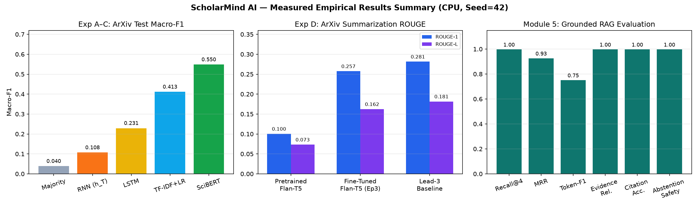
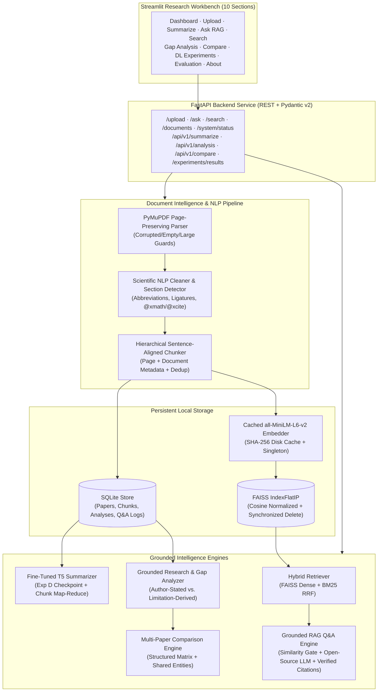
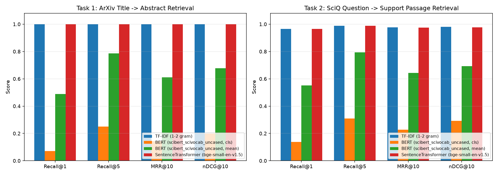

# ScholarMind AI — Research Paper Intelligence Assistant

> An end-to-end, CPU-compatible, evidence-grounded **AI Research Paper Intelligence Assistant** combining custom **PyTorch Deep Learning** (RNN, LSTM, BiLSTM+Attention), fine-tuned **Transformers** (`SciBERT`, `Flan-T5`), cached **Sentence Transformer** embeddings (`all-MiniLM-L6-v2`), persistent **FAISS + BM25 Hybrid Retrieval**, grounded **RAG Question Answering**, **FastAPI**, and a 10-section **Streamlit Research Workbench**.



---

## 1. Project Overview

**ScholarMind AI** enables researchers, students, and AI/ML engineers to upload scientific research PDFs and perform structured literature understanding without cloud lock-in or hallucinated claims:

- **Upload & Process Scientific PDFs** with exact page-number preservation, section detection, and unchanged-document deduplication.
- **Ask Technical & General Questions (Grounded RAG)** with verified `document_name` + `page_number` citations, cosine similarity scores clearly separated from factual probability, and explicit abstention when evidence is absent.
- **Run Hybrid Semantic Search** (`FAISS IndexFlatIP` + `BM25Okapi` via Reciprocal Rank Fusion) with paper and section-type filtering.
- **Summarize Long Papers** using our fine-tuned **T5** model (`flan-t5-small` Experiment D checkpoint) via single-pass or chunk-based hierarchical Map-Reduce.
- **Analyze Research Papers & Gaps** extracting verifiable objectives, methodologies, datasets, architectures, reported findings, explicit author-stated limitations, and evidence-tied future directions.
- **Compare Multiple Papers** side-by-side in an exportable comparison matrix highlighting shared datasets, architectures, and reported results.
- **Inspect Reproducible PyTorch Experiments (A–E)** and **RAG Evaluation Benchmarks** directly inside the interactive dashboard.

---

## 2. Problem Statement

Modern AI/ML literature grows by thousands of ArXiv preprints every month. Researchers face four compounding bottlenecks:
1. **Length & Structure Barrier:** Our EDA on `ccdv/arxiv-summarization` measured a mean article length of **6,244 words** (**100%** exceed BERT's 512-token limit; **78.75%** exceed 4,096 tokens), causing severe information loss in naive pipelines.
2. **Retrieval Vocabulary Mismatch:** Exact scientific acronyms/metrics (`ROUGE-L`, `DeBERTa-v3`, `LoRA`) require lexical precision while conceptual queries require dense semantic embeddings.
3. **Hallucination & Unverified Citations:** Naive LLM wrappers fabricate citations, invent research gaps not stated by authors, and answer out-of-scope questions confidently.
4. **Hardware Accessibility:** Production research tools must run reproducibly on ordinary **CPU-only laptops** while automatically scaling to CUDA/MPS GPUs when available.

---

## 3. System Architecture



For deeper architectural trade-offs and design rationale, see [ARCHITECTURE.md](docs/ARCHITECTURE.md), [ROADMAP.md](docs/ROADMAP.md), and [DATA_PREPROCESSING.md](docs/DATA_PREPROCESSING.md).

---

## 4. Technology Stack

| Layer | Technologies |
| :--- | :--- |
| **Language & Config** | Python 3.12, Pydantic v2, PyYAML, `python-dotenv` |
| **Data & Classical NLP** | Pandas, NumPy, PyArrow (Snappy Parquet), Scikit-Learn, NLTK, spaCy, `rank-bm25`, Matplotlib |
| **Deep Learning & Transformers** | PyTorch, Hugging Face `transformers`, `datasets`, `sentence-transformers`, `accelerate`, `rouge-score` |
| **Document Parsing & Vector DB** | PyMuPDF (`pymupdf`), FAISS CPU (`faiss-cpu`), SQLite |
| **Backend & Frontend** | FastAPI, Uvicorn, HTTPX, Streamlit |
| **Quality & Testing** | Pytest, Ruff |

---

## 5. Dataset References

All four reference corpora use manageable, streaming/scalable subsets (`mini`, `small`, `medium`, `full`) with strict pre-split deduplication, group-aware splitting, and automated cross-split leakage audits ([EDA_REPORT.md](docs/EDA_REPORT.md)):

| Dataset | Link | System Role |
| :--- | :--- | :--- |
| **1. ArXiv Metadata** | [Cornell-University/arxiv (Kaggle)](https://www.kaggle.com/datasets/Cornell-University/arxiv) | Multi-class scientific domain classification (Experiments A, B, C) & Title→Abstract retrieval (Experiment E). Supports manual Kaggle JSONL streaming + lightweight public ArXiv API sampling. |
| **2. SQuAD 2.0** | [rajpurkar/squad_v2 (Hugging Face)](https://huggingface.co/datasets/rajpurkar/squad_v2) | Offset-safe QA preprocessing, title-diverse balanced sampling (`27.4%` train / `46.0%` val unanswerable), and extractive unanswerable QA design. |
| **3. ArXiv Summarization** | [ccdv/arxiv-summarization (Hugging Face)](https://huggingface.co/datasets/ccdv/arxiv-summarization) | Long-document scientific summarization (Experiment D: Lead-3 vs. Pretrained vs. Fine-Tuned T5) and hierarchical parent-child scientific chunking (`5,624` chunks). |
| **4. SciQ** | [allenai/sciq (Hugging Face)](https://huggingface.co/datasets/allenai/sciq) | Scientific reading comprehension EDA (`88.57%` with support passages) and Question→Support retrieval benchmark (Experiment E). |

---

## 6. Model Descriptions (Honest Trained vs. Pretrained Breakdown)

| Model | Role | Training Status | Checkpoint / Source |
| :--- | :--- | :--- | :--- |
| **Vanilla RNN** (`VanillaRNNClassifier`) | Experiment A sequential baseline (last $h_T$ & mean pool) | **Trained from scratch** in PyTorch on ArXiv (`train=320`) | `artifacts/checkpoints/exp_a_rnn/best_model.pt` |
| **Unidirectional LSTM** (`LSTMClassifier`) | Experiment B gated memory baseline ($h_T, c_T$ inspection) | **Trained from scratch** in PyTorch on ArXiv (`train=320`) | `artifacts/checkpoints/exp_b_lstm/best_model.pt` |
| **2-Layer BiLSTM + Additive Attention** | Experiment B bidirectional sequence + token attention weights | **Trained from scratch** in PyTorch on ArXiv (`train=320`) | `artifacts/checkpoints/exp_b_bilstm_attn/best_model.pt` |
| **SciBERT** (`allenai/scibert_scivocab_uncased`) | Experiment C contextual embeddings & scientific classifier | **Fine-tuned** top-2 Transformer layers + head in PyTorch on ArXiv | `artifacts/checkpoints/exp_c_bert/best_model.pt` |
| **Flan-T5-Small** (`google/flan-t5-small`) | Experiment D & App Summarization (single-pass + Map-Reduce) | **Fine-tuned** in PyTorch on ArXiv Summarization (`3` epochs) | `artifacts/checkpoints/exp_d_t5/best_model.pt` |
| **MiniLM Embedder** (`sentence-transformers/all-MiniLM-L6-v2`) | Module 5 RAG dense embeddings (384-dim, SHA-256 cached) | **Pretrained inference** (cached offline locally) | `artifacts/hf_cache` |
| **BGE-Small Embedder** (`BAAI/bge-small-en-v1.5`) | Experiment E scientific retrieval comparison | **Pretrained inference** (cached offline locally) | `artifacts/hf_cache` |
| **Flan-T5-Base / Ollama** (`google/flan-t5-base` or `qwen2.5:3b`) | Module 5 RAG grounded answer generation | **Pretrained open-source inference** (zero paid APIs) | `artifacts/hf_cache` or local Ollama |

---

## 7. Installation Guide

### Prerequisites
- Python **3.10 – 3.12**
- 8–16 GB RAM (CPU-compatible out of the box; optional CUDA/MPS GPU auto-detected)

### Step 1: Clone & Create Virtual Environment
```bash
git clone <your-repo-url>
cd research-paper-intelligence-assistant

# Using standard venv + pip (CPU-optimized PyTorch wheel):
python -m venv .venv
# Windows:
.venv\Scripts\activate
# Linux/macOS:
source .venv/bin/activate

pip install --extra-index-url https://download.pytorch.org/whl/cpu -r requirements.txt
pip install -e .
```

*(Alternatively with `uv`: `uv venv .venv && uv pip install --python .venv -e ".[dev,ml]"`)*

### Step 2: Configure Environment & Prefetch Local Models
```bash
cp .env.example .env
python scripts/prefetch_pretrained_models.py
```

*(Optional)* For local Ollama LLM inference instead of default `google/flan-t5-base`, install Ollama, pull a lightweight model (`ollama pull qwen2.5:3b`), and set `SCHOLARMIND_LLM_PROVIDER=ollama` in `.env`.

---

## 8. Execution Instructions

### Run the Full Integrated Application (FastAPI + Streamlit)
Open two terminals (or run Streamlit standalone — it falls back seamlessly to the local in-process engine if FastAPI is not running):

```bash
# Terminal 1 — Start FastAPI Backend (OpenAPI Swagger UI at http://127.0.0.1:8000/docs)
python scripts/run_api.py

# Terminal 2 — Launch the 10-Section Streamlit Research Dashboard (http://localhost:8501)
python scripts/run_ui.py
```

### Reproduce Data Acquisition, EDA, Experiments & Evaluation
```bash
# 1. Acquire manageable dataset samples (scales cleanly via --scale mini|small|medium|full)
python scripts/download_datasets.py --scale mini --datasets all --arxiv-source auto

# 2. Run EDA, scientific NLP preprocessing, chunking & leakage-free splits
python scripts/run_eda_and_preprocess.py --scale mini --datasets all

# 3. Run PyTorch Deep Learning & NLP Experiments A–E (seed=42)
python scripts/run_experiments.py --experiments all --seed 42

# 4. Run Module 5 Quantitative RAG Evaluation
python scripts/evaluate_rag_module5.py

# 5. Run Complete Automated Test Suite & Linter
ruff check src tests scripts
pytest tests -v
```

Interactive Jupyter notebooks for each experiment live in `notebooks/01_experiment_a_rnn.ipynb` through `notebooks/05_experiment_e_embeddings.ipynb`.

---

## 9. API Documentation

Interactive Swagger documentation is available at `http://127.0.0.1:8000/docs`.

| Method | Endpoint | Description |
| :--- | :--- | :--- |
| `GET` | `/health` | Service health, indexed paper/vector counts, active LLM backend |
| `GET` | `/system/status` | Full Dashboard telemetry (documents, Q&A logs, checkpoint availability) |
| `GET` | `/experiments/results` | Sanitized saved JSON results for Experiments A–E, RAG eval & EDA |
| `POST` | `/upload` | Upload scientific PDF (preserves pages, skips unchanged duplicates, indexes FAISS) |
| `GET` | `/documents` | List all uploaded documents (zero internal file paths exposed) |
| `DELETE` | `/documents/{document_id}` | Synchronized removal from SQLite & FAISS vector index |
| `POST` | `/search` | Hybrid (`FAISS + BM25 RRF`), `dense`, or `lexical` search with filters |
| `POST` | `/ask` | Grounded RAG Q&A returning `question`, `answer`, `sources`, `retrieved_passages`, `similarity_scores`, `retrieval_status`, `abstained`, `evidence_note`, `latencies_ms` |
| `POST` | `/api/v1/summarize/{paper_id}` | Fine-tuned T5 summarization (`auto`, `hierarchical`, `single_pass`) |
| `GET` | `/api/v1/analysis/{paper_id}` | Grounded extraction of objectives, methods, datasets, models, findings, limitations & future work |
| `POST` | `/api/v1/compare` | Multi-paper comparison matrix across 2–10 uploaded papers |

**Example `/ask` Request & Response:**
```json
// POST /ask
{
  "question": "Which datasets were used to evaluate NeuroSparse?",
  "top_k": 4,
  "mode": "hybrid",
  "similarity_threshold": 0.34
}
```
```json
{
  "question": "Which datasets were used to evaluate NeuroSparse?",
  "answer": "ArXiv and SciQ datasets.\n\nSources: [1] Research_Paper_01.pdf (Page 1, Abstract).",
  "grounded": true,
  "abstained": false,
  "retrieval_status": "strong_evidence",
  "similarity_scores": [0.7142, 0.4218],
  "max_similarity_score": 0.7142,
  "evidence_note": "Strong retrieval match found in uploaded papers. Cosine similarity measures retrieval match between the question and passages, not the probability that an answer is factually correct.",
  "llm_backend": "local-pytorch:google/flan-t5-base",
  "sources": [
    {
      "rank": 1,
      "document_name": "Research_Paper_01.pdf",
      "page_number": 1,
      "section_title": "Abstract",
      "similarity_score": 0.7142,
      "quote": "We present NeuroSparse... evaluated on the ArXiv and SciQ datasets..."
    }
  ]
}
```

---

## 10. Evaluation Methodology

- **Leakage Prevention:** Pre-split deduplication, group-aware splits (`title_group` / `paper_id` / `support_group`), train-only RNN vocabulary, and automated `verify_no_leakage` assertions.
- **Classification (Exp A–C):** Fixed seed `42`, identical ArXiv splits (`320 / 42 / 42`), Majority & TF-IDF+LogReg baselines, per-epoch train/val loss, Accuracy, Macro-F1, and CPU latency.
- **Summarization (Exp D):** Extractive Lead-3 baseline, Zero-Shot vs. Hierarchical Map-Reduce vs. PyTorch Fine-Tuned `flan-t5-small` evaluated via `ROUGE-1`, `ROUGE-2`, and `ROUGE-L`.
- **Embeddings (Exp E):** Cosine retrieval evaluated via `Recall@1/5/10`, `MRR@10`, and `nDCG@10` on both ArXiv Title→Abstract and SciQ Question→Support.
- **End-to-End RAG (Module 5):** `Precision@4`, `Recall@4`, `MRR`, Answer Token-F1, Key-Term Coverage, Evidence Relevance, Exact Doc+Page Citation Correctness, Unsupported Answer Rate on out-of-scope queries, and stage-by-stage CPU latency.

---

## 11. Actual Experimental Results (Measured — Seed = 42)

Full breakdowns are available in [EXPERIMENTS_REPORT.md](docs/EXPERIMENTS_REPORT.md) and [MODULE5_RAG_REPORT.md](docs/MODULE5_RAG_REPORT.md).

### A. Scientific Domain Classification (Experiments A, B & C — ArXiv 8-Class)

| Model | Best Val Loss | Val Acc | Test Acc | Test Macro-F1 | Latency (ms/sample) |
| :--- | ---: | ---: | ---: | ---: | ---: |
| Baseline: Majority Class | — | 0.1905 | 0.1905 | 0.0400 | — |
| Baseline: TF-IDF + LogReg | — | 0.5714 | 0.4524 | 0.4129 | — |
| **Exp A:** Vanilla RNN (last $h_T$) | 2.1615 | 0.1190 | 0.1190 | 0.1083 | 0.43 |
| **Exp A:** Vanilla RNN (mean pool) | 2.0445 | 0.1905 | 0.2381 | 0.0794 | 0.67 |
| **Exp B:** Unidirectional LSTM | 1.6213 | 0.4286 | 0.2619 | 0.2305 | 1.17 |
| **Exp B:** 2-Layer BiLSTM + Attention | 2.0290 | 0.1667 | 0.2381 | 0.0826 | 4.65 |
| **Exp C:** SciBERT (top-2 layers + head) | **0.9066** | **0.7143** | **0.5714** | **0.5498** | 363.02 |

### B. T5 Scientific Summarization (Experiment D — ArXiv Summarization)

| Method | ROUGE-1 | ROUGE-2 | ROUGE-L | Val Loss |
| :--- | ---: | ---: | ---: | ---: |
| Baseline: Extractive Lead-3 | 0.2814 | 0.0820 | 0.1815 | — |
| Pretrained `flan-t5-small` (Zero-Shot) | 0.1004 | 0.0243 | 0.0733 | 3.3210 |
| **Fine-Tuned `flan-t5-small` (Epoch 3)** | **0.2574** | **0.0663** | **0.1623** | **3.0850** |

### C. Embedding Retrieval Benchmark (Experiment E)

| Representation Model | Dim | ArXiv Recall@1 | ArXiv nDCG@10 | SciQ Recall@1 | SciQ nDCG@10 | Query Latency (ms) |
| :--- | ---: | ---: | ---: | ---: | ---: | ---: |
| TF-IDF (1–2 gram) | 8K–17K | **1.0000** | **1.0000** | **0.9655** | **0.9800** | **0.07–0.17** |
| SciBERT (`[CLS]` pool) | 768 | 0.0714 | 0.1985 | 0.1379 | 0.2919 | 42.4–46.8 |
| SciBERT (Mean pool) | 768 | 0.4881 | 0.6780 | 0.5517 | 0.6934 | 43.1–48.8 |
| SentenceTransformer (`bge-small-en-v1.5`) | 384 | **1.0000** | **1.0000** | **0.9655** | **0.9777** | **16.4–18.0** |



### D. End-to-End Scientific RAG Evaluation (Module 5 — `all-MiniLM-L6-v2` + FAISS + `flan-t5-base`, CPU)

| Category | Metric | Measured Result |
| :--- | :--- | ---: |
| **Retrieval** | Precision@4 / Recall@4 / MRR | `0.4286` / **`1.0000`** / **`0.9286`** |
| **Answer Quality** | Answer Token-F1 / Key-Term Coverage | **`0.7535`** / **`0.8095`** |
| **Grounding & Safety** | Evidence Relevance / Exact Doc+Page Citation Accuracy / Unsupported Answer Rate | **`1.0000`** / **`1.0000`** / **`0.0000`** |
| **CPU Latencies** | PDF Parse / Cold Index / Cached Re-Upload / Retrieval / LLM Answer | `15.4 ms` / `2,978 ms` / **`4.9 ms`** / **`16.1 ms`** / `2,250 ms` |

---

## 12. Known Limitations

1. **Digital PDF Text Layer Required:** `PyMuPDFParser` handles digital multi-column PDFs cleanly and rejects scanned/image-only or encrypted PDFs safely; full OCR (e.g., Docling/Tesseract) is not enabled by default on CPU-lite mode.
2. **Small-Sample Training Variance:** Experiments A–D were executed on CPU-practical `mini` splits (`train=320` ArXiv, `train=48` ArXiv Summarization); higher-capacity models (e.g., 2-layer BiLSTM) benefit significantly when scaled to `--scale medium` or `full` on GPU.
3. **Lightweight Local LLM Context:** `google/flan-t5-base` provides fast, zero-dependency CPU generation (~2.25 s/query) but produces concise answers; connecting a 3B–8B Ollama model (`qwen2.5:3b` / `llama3.2:3b`) yields richer multi-paragraph synthesis.
4. **Rule-Assisted Structured Analysis:** Research Gap & Analysis extraction prioritizes **zero fabrication** via curated scientific entity patterns and verbatim sentence provenance rather than unconstrained LLM speculation.

---

## 13. Future Improvements

- Plug in **Docling / Marker** vision-based layout & LaTeX table extraction under `gpu_consumer` / `gpu_research` profiles.
- Add **Cross-Encoder Reranking** (`BAAI/bge-reranker-v2-m3` / `ms-marco-MiniLM-L-6-v2`) after FAISS + BM25 RRF fusion.
- Scale **Experiment D** to **LongT5 (`google/long-t5-tglobal-base`) with LoRA** on 4K–8K token full-paper windows on GPU.
- Add **SciBERT / DeBERTa-v3 Extractive QA** fine-tuned on our preprocessed **SQuAD 2.0 + SciQ** splits as a span-level claim verifier inside RAG.
- Add **Docker Compose** (`api` + `ui` + `ollama`) and GitHub Actions CI running `ruff` + `pytest`.
