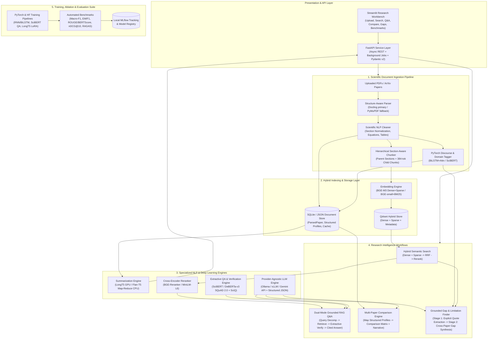
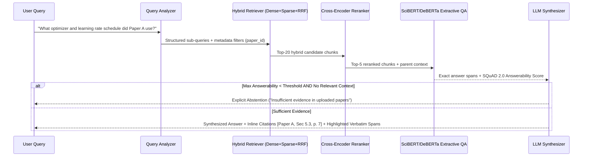

# System Architecture & Technical Design Document
## Research Paper Intelligence Assistant (`ScholarMind AI`)

**Role Perspective:** AI Research Engineer & Software Architect  
**Target Domain:** Scientific Literature Understanding, Multi-Document Synthesis & Research Intelligence  
**Design Philosophy:** Evaluation-driven, modular, hardware-adaptive, and grounded in scientific provenance (zero unverified claims).

---

## 1. Requirements Analysis

### 1.1 Functional Requirements

| ID | Capability | Concrete Engineering Specification |
| :--- | :--- | :--- |
| **FR-1** | **PDF Scientific Parsing** | Ingest single or multiple research PDFs; preserve multi-column reading order, section hierarchy (`Abstract`, `Introduction`, `Method`, `Results`, `Limitations`, `Conclusion`), tables, figure captions, and math expressions. |
| **FR-2** | **Structured Information Extraction** | Extract paper metadata (title, authors, venue/year, domain categories) and structured research attributes (problem, methodology, datasets, baselines, metrics, results, limitations). |
| **FR-3** | **Multi-Granularity Summarization** | Generate *One-Line TL;DR*, *Structured Executive Summary* (Problem / Method / Findings / Limitations), and *Section-by-Section Digests* using fine-tuned Seq2Seq/T5 models and/or LLM synthesis. |
| **FR-4** | **Grounded Question Answering** | Answer user questions over uploaded PDFs with **inline section/page citations**, verbatim evidence snippets, and explicit **abstention ("Not answered in the provided papers")** when evidence is absent. |
| **FR-5** | **Semantic & Hybrid Search** | Perform fast dense + lexical hybrid search across uploaded papers and an indexed ArXiv reference corpus, with metadata filtering (`category`, `section`, `year`, `paper_id`) and cross-encoder reranking. |
| **FR-6** | **Multi-Paper Comparison** | Compare 2–10 uploaded papers across standardized research dimensions via a structured **Comparison Matrix** plus a critical comparative narrative (trade-offs, contradictions, evolution). |
| **FR-7** | **Research Gap & Limitation Analysis** | Distinguish between **(a) Author-Stated Limitations** (extracted with verbatim quotes) and **(b) Synthesized Cross-Paper Gaps** (untested domains, missing baselines, scalability limits, conflicting findings). |
| **FR-8** | **Research Benchmarks & Ablations** | Provide reproducible training, evaluation, and ablation scripts demonstrating measurable performance gains across model families (RNN → BiLSTM+Attention → BERT/SciBERT → T5/LongT5 → Hybrid RAG+LLM). |

### 1.2 Non-Functional Requirements

- **Hardware Portability:** Must run end-to-end on a **CPU-only laptop (16 GB RAM)** via lightweight/quantized profiles while scaling automatically to **consumer GPUs (8–16 GB VRAM)** and **research GPUs (24–80 GB VRAM)**.
- **Provenance & Hallucination Resistance:** Every claim in Q&A, comparisons, and gap reports must link back to a `paper_id`, `section_title`, `page_number`, and verbatim `chunk_id`.
- **Modularity & Extensibility:** Strict separation between PDF parsing, ML model wrappers, retrieval infrastructure, business logic, API (`FastAPI`), and UI (`Streamlit`). Swapping an embedding model, vector DB, or LLM provider requires only a YAML config change.
- **Reproducibility:** Deterministic seeds, versioned YAML configs, parquet-serialized dataset splits, and automated evaluation suites (`ROUGE`, `BERTScore`, `EM/F1`, `nDCG@10`, `MRR`, `RAGAS`).

### 1.3 Skill Demonstration Matrix (No "Toy" Bolting-On)

Every required technical domain serves a **load-bearing architectural purpose** rather than an isolated demo:

| Required Skill | Architectural Role in `ScholarMind AI` |
| :--- | :--- |
| **Python** | Clean typed Python 3.11+ package (`pydantic` v2, `asyncio`, dependency injection, `pytest`, CLI & FastAPI services). |
| **NLP** | Scientific text cleaning, citation-span normalization, section-aware semantic chunking, BM25 lexical scoring, rhetorical role tagging. |
| **Deep Learning & PyTorch** | Custom `nn.Module` architectures, custom `Dataset`/`DataLoader` with dynamic padding (`pack_padded_sequence`), custom training loops (AMP mixed precision, gradient clipping, cosine scheduling, early stopping, checkpointing). |
| **RNN & LSTM** | **(1) BiLSTM + Additive Self-Attention** scientific paper domain & rhetorical-role classifier (benchmarked against Vanilla RNN & SciBERT); **(2) GRU/LSTM Seq2Seq + Bahdanau Attention** summarization baseline empirically demonstrating why Transformers replace RNNs on long papers. |
| **Transformers** | Multi-head attention mechanics, positional/long-context attention (`TGlobal` in LongT5), PEFT/LoRA fine-tuning, and cross-encoder reranking. |
| **BERT (SciBERT / DeBERTa-v3)** | Fine-tuned on **SQuAD 2.0 + SciQ** for **Extractive QA + Unanswerable Detection** (evidence verification layer) and **SciBERT** for scientific domain classification & limitation-sentence scoring. |
| **T5 (Flan-T5 / LongT5)** | Fine-tuned on **ArXiv Summarization** for abstractive scientific summarization (LongT5 single-pass on GPU; Flan-T5 hierarchical map-reduce on CPU). |
| **Embeddings** | Hybrid Dense + Sparse embeddings (`BGE-M3` / `BGE-small`) compared against citation-aware scientific embeddings (`SPECTER2`) on ArXiv retrieval benchmarks. |
| **LLMs** | Provider-agnostic LLM engine (local quantized open-weights via Ollama/`llama.cpp`/vLLM OR cloud API like Gemini/OpenAI) with strict Pydantic structured outputs for comparison matrices, multi-hop synthesis, and gap discovery. |
| **RAG** | Production-grade Hybrid RAG: query decomposition → dense+sparse retrieval → Reciprocal Rank Fusion (RRF) → cross-encoder reranking → dual extractive/generative grounded answering → RAGAS evaluation. |

---

## 2. Technology, Model & Library Selection (Engineering Trade-Off Analysis)

### 2.1 Scientific PDF Parsing & Layout Extraction

| Candidate | Strengths | Weaknesses | Architectural Decision |
| :--- | :--- | :--- | :--- |
| **Docling (IBM Research)** | MIT license; SOTA layout analysis; preserves multi-column order & section hierarchy; dedicated TableFormer for complex academic tables; clean Markdown/JSON export. | Downloads ~1–2 GB weights on first run; ~1–3s/page on CPU. | **Primary Parser** (`gpu_consumer`, `gpu_research`, and quality CPU mode). |
| **PyMuPDF4LLM (`fitz`)** | Blazing fast (milliseconds/page); tiny footprint (~15 MB); zero model downloads; solid on clean single-column born-digital PDFs. | Can scramble complex two-column layouts, borderless tables, and dense equations. | **Fast CPU-Lite Fallback** (`cpu_lite` profile & rapid preview mode). |
| **Marker (Surya OCR)** | Fast GPU throughput; strong equation-to-LaTeX extraction. | GPL license; heavier GPU requirement. | Optional plugin backend for math-heavy LaTeX extraction. |
| **GROBID** | Gold standard for bibliographic TEI-XML & reference parsing. | Requires Java/Docker runtime; heavier operational footprint. | Out-of-scope for v1 local setup; supported as an optional citation-enrichment adapter in Phase 7. |

**Decision:** Implement an abstract `BasePDFParser` with **`DoclingParser`** as primary and **`PyMuPDFParser`** as fast CPU fallback, outputting a canonical `ParsedPaper` Pydantic schema (metadata, hierarchical `Section` objects, `Table` objects, `Equation` blocks, and page coordinates).

### 2.2 Foundational Deep Learning Models (Custom PyTorch)

- **Model 1 — Scientific Text Classifier (`VanillaRNN` vs. `BiLSTMWithAttention`):**
  - **Task:** Multi-label arXiv category classification (`cs.AI`, `cs.CL`, `cs.LG`, `cs.CV`, `stat.ML`, etc.) + rhetorical sentence classification (`Objective`, `Method`, `Result`, `Limitation`).
  - **Why BiLSTM + Additive Attention:** Bidirectional recurrence captures left-and-right scientific context around technical terms, while the attention pooling layer produces interpretable token-level importance weights (visualizable in the UI!). Comparing `Vanilla RNN` → `BiLSTM` → `BiLSTM + Attention` → `SciBERT` provides a textbook research ablation.
- **Model 2 — Seq2Seq Summarization Baseline (`LSTMSeq2SeqWithBahdanauAttention`):**
  - **Task:** Baseline abstract generation on truncated Introduction+Conclusion pairs from `ccdv/arxiv-summarization`.
  - **Why:** Demonstrates encoder-decoder recurrence, teacher forcing, beam search, and empirically highlights long-range context degradation vs. `T5`/`LongT5`.

### 2.3 Encoder Transformers (BERT Family)

| Task | GPU / High-Accuracy Model | CPU-Lite Model | Rationale |
| :--- | :--- | :--- | :--- |
| **Extractive QA & Unanswerable Detection** | `microsoft/deberta-v3-base` (or `allenai/scibert_scivocab_uncased`) fine-tuned on SQuAD 2.0 + SciQ | `deepset/minilm-uncased-squad2` or ONNX INT8 quantized `SciBERT` | **SciBERT** provides a domain-specific scientific vocabulary (`scivocab`) avoiding fragmented technical tokens; **DeBERTa-v3** disentangled attention delivers superior span boundary precision and SQuAD 2.0 null-score discrimination. |
| **Scientific Classification & Limitation Cue Tagging** | `allenai/scibert_scivocab_uncased` | `SciBERT` (ONNX INT8) or `BiLSTM+Attention` | Pretrained on 1.14M Semantic Scholar papers (82% biomed, 18% CS); outperforms general BERT-base on scientific discourse tasks. |

### 2.4 Encoder-Decoder Transformers (T5 Family)

| Tier | Model | Context Length | Strategy |
| :--- | :--- | :--- | :--- |
| **GPU (`gpu_consumer` / `gpu_research`)** | `google/long-t5-tglobal-base` (247M params) | 4,096 – 8,192 tokens | Transient Global (`TGlobal`) attention ingests full/condensed papers in a single pass; fine-tuned via **LoRA (PEFT)** + BF16/FP16 + gradient checkpointing on `ccdv/arxiv-summarization`. |
| **CPU (`cpu_lite`)** | `google/flan-t5-base` (248M) or `google/flan-t5-small` (77M, ONNX INT8) | 512 – 1,024 tokens | **Hierarchical Map-Reduce Summarization:** summarizes each parsed section (`Introduction`, `Method`, `Experiments`, `Conclusion`) independently, then reduces section summaries into a cohesive paper abstract. |

### 2.5 Embeddings, Vector Store & Reranking

- **Primary Embedding Model:** **`BAAI/bge-m3`** (~568M params, 8,192-token window, MIT license).
  - *Why:* Uniquely emits **Dense + Sparse (lexical weights) + Multi-vector** embeddings in one forward pass. Scientific search requires **both** semantic understanding ("parameter-efficient adaptation") and exact lexical precision ("LoRA", "RoBERTa-large", "BLEU-4", "F1=89.2").
- **CPU-Lite Embedding Model:** **`BAAI/bge-small-en-v1.5`** (~33M params, 384-dim) paired with **`rank-bm25`** lexical scoring fused via **Reciprocal Rank Fusion (RRF)**.
- **Research Benchmark Baseline:** **`allenai/specter2_base`** (citation-informed scientific encoder) evaluated alongside `bge-small` and `bge-m3` on ArXiv retrieval (`Recall@10`, `MRR@10`, `nDCG@10`).
- **Vector Store:**
  - **Primary:** **Qdrant** in embedded local mode (`QdrantClient(path="./data/qdrant_db")`) — zero Docker dependency during development, native support for **named Dense + Sparse hybrid vectors** and rich payload filtering (`paper_id`, `section_type`, `year`, `categories`), seamlessly upgradeable to Qdrant Server/Cloud.
  - **Secondary / Research Benchmark:** **FAISS** (`IndexFlatIP` / `IndexHNSWFlat`) for offline high-speed ArXiv corpus ANN benchmarking.
- **Cross-Encoder Reranker:**
  - GPU: **`BAAI/bge-reranker-v2-m3`** (or `Qwen3-Reranker-0.6B`)
  - CPU: **`cross-encoder/ms-marco-MiniLM-L-6-v2`** (~22M params, fast CPU inference)

### 2.6 LLM Reasoning Layer & Structured Outputs

Because research engineers frequently switch between privacy-preserving local weights and frontier cloud APIs, the LLM layer uses a **strict Provider-Agnostic Interface (`BaseLLMClient`)** enforcing **Pydantic v2 JSON Schema outputs**:

| Mode | Backend | Recommended Models | Best For |
| :--- | :--- | :--- | :--- |
| **Cloud Frontier (Recommended for Quality)** | Gemini API (`google-genai`) or OpenAI-compatible API | `gemini-2.5-flash` / `gemini-2.5-pro` (or GPT-4o / Claude) | Highest accuracy on multi-paper synthesis, nuanced limitation extraction, and RAGAS LLM-as-a-Judge evaluation; zero local VRAM cost. |
| **Local Consumer GPU** | Ollama / `vLLM` | `Qwen2.5-7B-Instruct` (Q4_K_M / AWQ) or `Llama-3.1-8B-Instruct` | 100% offline, private, reproducible local execution on 8–12 GB VRAM. |
| **Local CPU-Only** | Ollama / `llama-cpp-python` | `Qwen2.5-3B-Instruct` (Q4_K_M) or `Llama-3.2-3B-Instruct` | Fully offline laptop execution (3–5 GB RAM footprint). |

### 2.7 Core Python Stack

- **Deep Learning & NLP:** `torch`, `transformers`, `peft`, `accelerate`, `datasets`, `sentence-transformers`, `evaluate`, `rouge-score`, `bert-score`, `rank-bm25`, `nltk`, `spacy`
- **Quantization & Optimization:** `bitsandbytes` (GPU 4-bit/8-bit), `optimum[onnxruntime]` (CPU INT8 quantization)
- **PDF & Document Processing:** `docling`, `pymupdf4llm`, `pymupdf`
- **Retrieval & Evaluation:** `qdrant-client`, `faiss-cpu`, `ragas`
- **Backend, Validation & UI:** `fastapi`, `uvicorn`, `pydantic>=2.0`, `pydantic-settings`, `streamlit`, `plotly`
- **Experiment Tracking & Engineering:** `mlflow` (local file store), `loguru`, `pyyaml`, `pytest`, `ruff`, `mypy`

---

## 3. System Architecture

### 3.1 High-Level Architectural Diagram



### 3.2 Key Architectural Flows

#### Flow A: Hierarchical Section-Aware Ingestion
1. **Parse:** `Docling` extracts reading-order blocks, tables (as Markdown + JSON), headings, and page numbers into `ParsedPaper`.
2. **Enrich:** The PyTorch `BiLSTM+Attention` / `SciBERT` classifier tags the paper's arXiv discipline(s) and annotates candidate sentences (`Method`, `Result`, `Limitation/Future Work`).
3. **Chunk (Parent-Child Strategy):**
   - **Parent Chunks:** Complete sections (or 1,500-token sub-sections) stored in SQLite/JSON for broad context expansion during generation.
   - **Child Chunks:** 350–450 token sliding windows (64-token overlap) prefixed with contextual breadcrumb headers (`"[Paper: Attention Is All You Need | Section: 3.2 Multi-Head Attention | Page: 4]"`), embedded into Qdrant with dense + sparse vectors and rich metadata.

#### Flow B: Dual-Mode Grounded RAG Q&A (Anti-Hallucination Design)


#### Flow C: Multi-Paper Comparison (`Map-Extract-Synthesize`)
Rather than stuffing 5 raw PDFs (50,000+ tokens) into a single noisy prompt (which triggers "lost-in-the-middle" degradation), comparison runs in two structured stages:
1. **Map (Per-Paper Cached Extraction):** Extract a strict Pydantic `PaperStructuredProfile` once per paper (cached in SQLite):
   - `research_problem`, `core_hypothesis`, `methodology_summary`, `model_architecture`, `datasets_used`, `evaluation_metrics`, `headline_results`, `compute_requirements`, `key_assumptions`, `stated_limitations`.
2. **Synthesize (Cross-Paper Matrix & Critique):** Align $N$ `PaperStructuredProfile` objects into a unified comparison table (highlighting common datasets/metrics, apples-to-oranges caveats, methodological differences, and chronological progress).

#### Flow D: Two-Stage Grounded Research Gap & Limitation Discovery
To eliminate hallucinated research gaps (a known failure mode in scientific LLMs):
1. **Stage 1 — Explicit Limitation Extraction (High Precision):**
   - Retrieve chunks tagged with section types `Limitations`, `Discussion`, `Conclusion`, `Future Work`, `Threats to Validity`, plus sentences scored high by the **SciBERT Limitation-Cue Classifier**.
   - Extract structured `ExplicitLimitation` objects containing `category` (`Data`, `Compute`, `Evaluation`, `Generalization`, `Theoretical`), `description`, `verbatim_quote`, `paper_id`, and `page_num`.
   - Programmatically verify that `verbatim_quote` exists (fuzzy substring match ≥ 0.90) in the source paper!
2. **Stage 2 — Synthesized Cross-Paper Gap Analysis (High Insight):**
   - Feed the extracted `PaperStructuredProfile`s + `ExplicitLimitation`s across selected papers to the LLM with a structured `ResearchGapHypothesis` schema.
   - Detect structural gaps: *untested benchmark combinations*, *unaddressed failure modes shared across papers*, *contradictory empirical claims*, and *missing ablations*.
   - Every output item is explicitly badged as either **`[Author-Stated]`** or **`[AI-Synthesized Hypothesis]`** with supporting citations.

---

## 4. Dataset-to-Module Mapping & Data Engineering Strategy

All four reference datasets are integrated into dedicated training, indexing, and evaluation pipelines with streaming and stratified subsetting so experiments run smoothly on both laptops and GPU servers.

| Dataset | Size & Splits | Schema Fields | Assigned System Module(s) | Data Engineering & Usage Strategy |
| :--- | :--- | :--- | :--- | :--- |
| **1. ArXiv Metadata (`Cornell-University/arxiv`)** | ~3+ GB JSONL (~1.7M–2.4M+ papers; unsplit catalog) | `id`, `title`, `abstract`, `authors`, `categories`, `versions`, `doi`, `journal-ref` | **(a) PyTorch RNN / BiLSTM+Attn vs. SciBERT Classifier**<br>**(b) Semantic Search Reference Corpus & Embedding Ablation** | Stream JSONL line-by-line (never load full file into RAM). Filter top 8–10 AI/ML/CS categories (`cs.AI`, `cs.CL`, `cs.LG`, `cs.CV`, `cs.IR`, `cs.NE`, `stat.ML`, `cs.RO`). Create reproducible Parquet splits: 50K train / 5K val / 5K test for classification, and a 50K–100K abstract corpus for semantic search & `BGE-M3` vs. `SPECTER2` retrieval benchmarks. |
| **2. SQuAD 2.0 (`rajpurkar/squad_v2`)** | ~128.5 MB<br>Train: 130,319<br>Val: 11,873 | `id`, `title`, `context`, `question`, `answers` (`text`, `answer_start`) | **Extractive QA & Unanswerable Detection Engine (`BERT` / `SciBERT` / `DeBERTa-v3`)** | Fine-tune with sliding window (`max_length=512`, `doc_stride=128`) and tuned CLS null-score threshold $\tau$. Teaches exact span extraction AND **crucial abstention behavior** on unanswerable questions (preventing hallucination in scientific Q&A). |
| **3. ArXiv Summarization (`ccdv/arxiv-summarization`)** | ~7.6 GB<br>Train: 203,037<br>Val: 6,436<br>Test: 6,440 | `id`, `article` (full body), `abstract` (target summary) | **Abstractive Summarization Engine (`LongT5` / `Flan-T5` + `LSTM Seq2Seq` baseline)** | Load via Hugging Face `streaming=True` into curated Parquet slices: e.g., **5K/20K train**, **1K val**, **1K test** (scalable to full 203K on research GPUs). Preserve section headers (`<sec>`) during preprocessing; evaluate with ROUGE-1/2/L & BERTScore. |
| **4. SciQ (`allenai/sciq`)** | ~10 MB<br>Train: 11,679<br>Val: 1,000<br>Test: 1,000 | `question`, `correct_answer`, `distractor1..3`, `support` | **(a) Scientific Domain QA Adaptation & Eval**<br>**(b) Hard-Negative Retrieval Evaluation**<br>**(c) RAG vs. Closed-Book LLM Benchmark** | (1) Adapt SQuAD 2.0 QA model to scientific passages (`support` + `question` → `correct_answer`). (2) Use `distractor1..3` as hard negatives to test semantic ranking & RAG faithfulness. (3) Benchmark RAG grounded on `support` passages vs. zero-shot LLM accuracy. |

---

## 5. Hardware, Computational Requirements & CPU/GPU Compatibility

### 5.1 Three-Tier Hardware Profile System

Rather than hardcoding models that crash on CPU laptops or underutilize GPUs, the system loads one of three YAML hardware profiles (`configs/profiles/*.yaml`):

| Component | Tier 1: `cpu_lite` (Laptop CPU, 16 GB RAM, 0 GB VRAM) | Tier 2: `gpu_consumer` (RTX 3060/4060/4070 or Colab T4, 8–16 GB VRAM) | Tier 3: `gpu_research` (RTX 4090 / A100 / L40S, 24–80 GB VRAM) |
| :--- | :--- | :--- | :--- |
| **PDF Parser** | `PyMuPDF4LLM` (fast) or `Docling` (CPU, OCR off) | `Docling` (GPU accelerated) | `Docling` / `Marker` (batched GPU) |
| **RNN / BiLSTM Classifier** | PyTorch CPU FP32 (trains on 20K subset in ~5–10 min) | PyTorch CUDA FP16 (<1 min) | PyTorch CUDA BF16 (<20 sec) |
| **Extractive QA (BERT)** | `MiniLM-L6-SQuAD2` or ONNX INT8 `SciBERT` (inference only / small slice) | `SciBERT` / `DeBERTa-v3-base` (FP16 + grad accum) | `DeBERTa-v3-large` (BF16 full SQuAD 2.0 + SciQ) |
| **Summarizer (T5)** | `flan-t5-small` / `flan-t5-base` (ONNX INT8, Map-Reduce) | `long-t5-tglobal-base` (LoRA/PEFT, 4,096 tok, FP16 + grad ckpt) | `long-t5-tglobal-large` (8,192–16,384 tok, BF16) |
| **Embeddings** | `BAAI/bge-small-en-v1.5` (~130 MB) + `BM25` | `BAAI/bge-m3` (~2.2 GB FP16, Dense+Sparse) | `BAAI/bge-m3` or `Qwen3-Embedding-4B/8B` |
| **Reranker** | `ms-marco-MiniLM-L-6-v2` (~90 MB) | `BAAI/bge-reranker-v2-m3` (~1.1 GB FP16) | `BAAI/bge-reranker-v2-m3` / `Qwen3-Reranker` |
| **LLM Backend** | Cloud API (Gemini/OpenAI) OR Ollama `Qwen2.5-3B` Q4_K_M | Cloud API OR Ollama `Qwen2.5-7B` Q4_K_M (~5 GB VRAM) | Local `vLLM` `Qwen2.5-14B/32B` or Cloud Frontier API |
| **Storage Needs** | ~5–10 GB disk (subsets + quantized models) | ~25–40 GB disk | ~80–150 GB disk (full datasets + checkpoints) |

### 5.2 Per-Module Compute & Memory Budget

| Module | Training Compute (1 Epoch / Subset) | Inference Latency (CPU / Consumer GPU) | Peak RAM / VRAM (Inference) |
| :--- | :--- | :--- | :--- |
| **BiLSTM + Attention** (50K ArXiv) | ~8 min CPU / ~35 sec T4 GPU | ~4 ms / ~0.5 ms per abstract | ~300 MB |
| **SciBERT / DeBERTa-v3 QA** (SQuAD 2.0) | Fine-tune on GPU (~25–45 min on T4/4060, 3 epochs) | ~60 ms (INT8 CPU) / ~8 ms (GPU) per chunk | ~450 MB (INT8) / ~1.2 GB (FP16) |
| **LongT5-base LoRA** (15K ArXiv Summ) | GPU required (~2–3 hrs on 16 GB GPU, 4k ctx, grad ckpt) | ~12s Map-Reduce (Flan-T5 CPU) / ~2.5s (LongT5 GPU) | ~600 MB (Flan-T5 INT8) / ~3.5 GB (LongT5 FP16) |
| **BGE-M3 / BGE-small** | Pretrained (zero-shot / optional contrastive eval) | ~25 ms/chunk (BGE-small CPU) / ~5 ms (BGE-M3 GPU) | ~200 MB / ~2.2 GB |
| **Docling PDF Parse** (10-page paper) | N/A | ~15–25s CPU / ~3–5s GPU (PyMuPDF: <0.3s CPU) | ~2.5 GB RAM / ~2.0 GB VRAM |

### 5.3 Cross-Hardware Engineering Patterns

1. **Unified Device & Precision Manager (`src/core/device.py`):** Auto-detects `cuda` → `mps` → `cpu`, selects `bfloat16` on Ampere+ GPUs, `float16` on Turing/Volta, and `float32`/ONNX `int8` on CPU.
2. **Model Lifecycle & Memory Manager (`src/core/model_registry.py`):** Implements **lazy loading + LRU eviction** with `torch.cuda.empty_cache()` / `gc.collect()`. On an 8 GB VRAM GPU, loading `Docling` + `BGE-M3` + `LongT5` + `SciBERT` + `7B LLM` simultaneously would cause OOM; the registry keeps only active stage models resident and cleanly swaps them on demand.
3. **Training-Inference Decoupling:** Heavy fine-tuning (`DeBERTa-v3` on SQuAD 2.0, `LongT5` LoRA on ArXiv Summarization) can be executed via identical CLI scripts on **Google Colab / Kaggle GPUs / Cloud GPUs**, exporting lightweight adapters/ONNX weights directly into `artifacts/models/` for seamless local CPU or GPU inference.

---

## 6. Scalable & Modular Folder Structure

```text
research-paper-intelligence-assistant/
├── README.md
├── pyproject.toml                       # Modern dependency management (uv / pip), ruff, mypy, pytest
├── .env.example                         # API keys (GEMINI_API_KEY, etc.), profile overrides
├── configs/
│   ├── base.yaml                        # Shared app, chunking, RAG, and evaluation defaults
│   ├── profiles/
│   │   ├── cpu_lite.yaml                # Tier 1: Laptop CPU-only configuration
│   │   ├── gpu_consumer.yaml            # Tier 2: 8-16 GB VRAM GPU configuration
│   │   └── gpu_research.yaml            # Tier 3: 24-80 GB VRAM research GPU configuration
│   └── training/
│       ├── rnn_bilstm_arxiv.yaml        # Hyperparameters for RNN/BiLSTM experiments
│       ├── scibert_squad_sciq.yaml      # Hyperparameters for BERT/DeBERTa Extractive QA
│       └── longt5_arxiv_summ.yaml       # Hyperparameters for T5/LongT5 LoRA summarization
│
├── docs/
│   ├── ARCHITECTURE.md                  # This architecture & technical design document
│   └── ROADMAP.md                       # Phased development roadmap & acceptance criteria
│
├── src/
│   └── scholarmind/
│       ├── __init__.py
│       ├── core/                        # Shared infrastructure & cross-cutting concerns
│       │   ├── config.py                # Pydantic settings + YAML profile loader
│       │   ├── device.py                # Auto CUDA/MPS/CPU, AMP dtype, seed utilities
│       │   ├── model_registry.py        # Lazy model loader & VRAM/RAM LRU cache manager
│       │   ├── schemas.py               # Canonical Pydantic schemas (ParsedPaper, Chunk, Profile, Gap)
│       │   └── logging.py               # Structured logging (loguru)
│       │
│       ├── data/                        # Dataset loaders, streamers & preprocessors
│       │   ├── arxiv_loader.py          # Streaming JSONL parser & stratified Parquet builder
│       │   ├── squad_loader.py          # SQuAD 2.0 sliding-window tokenizer & offset mapper
│       │   ├── arxiv_summ_loader.py     # Streaming ccdv/arxiv-summarization preprocessor
│       │   └── sciq_loader.py           # SciQ QA + hard-negative distractor dataset builder
│       │
│       ├── ingestion/                   # Scientific PDF parsing & section-aware chunking
│       │   ├── base.py                  # BasePDFParser interface
│       │   ├── docling_parser.py        # Layout, table & section hierarchy parser
│       │   ├── pymupdf_parser.py        # Fast CPU-lite fallback parser
│       │   ├── cleaner.py               # Scientific NLP cleaning, LaTeX & citation normalization
│       │   └── chunker.py               # Hierarchical parent-child section-aware chunker
│       │
│       ├── models/                      # All ML/DL model definitions & inference wrappers
│       │   ├── rnn_lstm/                # Custom PyTorch sequence models (from scratch)
│       │   │   ├── vocab.py             # Tokenizer, vocabulary & pretrained embedding loader
│       │   │   ├── vanilla_rnn.py       # Baseline RNN classifier
│       │   │   ├── bilstm_attention.py  # BiLSTM + Additive Self-Attention classifier (with attn weights)
│       │   │   └── seq2seq_lstm.py      # LSTM Encoder-Decoder + Bahdanau Attention baseline
│       │   ├── bert/                    # Encoder Transformers (BERT / SciBERT / DeBERTa-v3)
│       │   │   ├── extractive_qa.py     # SQuAD 2.0 / SciQ span extractor + null-score abstention
│       │   │   └── sci_classifier.py    # SciBERT domain & limitation-cue classifier
│       │   ├── t5/                      # Encoder-Decoder Transformers (T5 / Flan-T5 / LongT5)
│       │   │   ├── summarizer.py        # LongT5 single-pass + Flan-T5 hierarchical map-reduce
│       │   │   └── onnx_export.py       # INT8 ONNX export for fast CPU inference
│       │   ├── embeddings/              # Dense, Sparse & Scientific embedding wrappers
│       │   │   ├── base.py
│       │   │   ├── bge_embedder.py      # BGE-M3 (dense+sparse) & BGE-small wrapper
│       │   │   └── specter2_embedder.py # SPECTER2 scientific baseline embedder
│       │   └── llm/                     # Provider-agnostic LLM abstraction
│       │       ├── base.py              # BaseLLMClient with strict Pydantic structured output
│       │       ├── ollama_client.py     # Local CPU/GPU GGUF/Ollama backend
│       │       └── api_client.py        # Cloud API backend (Gemini / OpenAI-compatible)
│       │
│       ├── retrieval/                   # Indexing, hybrid search & reranking
│       │   ├── qdrant_store.py          # Embedded/Server Qdrant dense+sparse hybrid store
│       │   ├── faiss_store.py           # FAISS ANN store for ArXiv retrieval benchmarks
│       │   ├── bm25_index.py            # Lexical BM25 index (for CPU-lite hybrid search)
│       │   ├── hybrid_retriever.py      # Dense + Sparse/BM25 + RRF fusion + metadata filters
│       │   └── reranker.py              # Cross-encoder reranker (BGE-Reranker / MiniLM)
│       │
│       ├── workflows/                   # High-level research intelligence orchestrators
│       │   ├── document_store.py        # SQLite persistence for ParsedPaper & cached profiles
│       │   ├── summarization_service.py # Multi-granularity summarization (T5 + LLM polish)
│       │   ├── rag_qa_service.py        # Dual-mode RAG Q&A (Query decomp + Extractive + LLM)
│       │   ├── comparison_service.py    # Map-Extract-Synthesize multi-paper comparison matrix
│       │   └── gap_analysis_service.py  # Two-stage grounded limitation & research gap finder
│       │
│       ├── training/                    # Reproducible PyTorch & HF training pipelines
│       │   ├── train_rnn_lstm.py        # Custom PyTorch loop (AMP, clipping, early stop, MLflow)
│       │   ├── train_bert_qa.py         # HF Trainer for SciBERT/DeBERTa on SQuAD 2.0 + SciQ
│       │   ├── train_scibert_cls.py     # SciBERT classification benchmark vs. BiLSTM
│       │   └── train_t5_summarizer.py   # LoRA/PEFT LongT5 / Flan-T5 training on ArXiv Summ
│       │
│       ├── evaluation/                  # Quantitative benchmarks & ablation runners
│       │   ├── classification_eval.py   # Accuracy, Macro-F1, latency (RNN vs BiLSTM vs SciBERT)
│       │   ├── qa_eval.py               # SQuAD 2.0 EM/F1 (HasAns/NoAns) + SciQ accuracy
│       │   ├── summarization_eval.py    # ROUGE-1/2/L, BERTScore, compression ratio
│       │   ├── retrieval_eval.py        # Recall@k, MRR@10, nDCG@10 (BM25 vs Dense vs Hybrid vs Rerank)
│       │   └── rag_eval.py              # RAGAS (Faithfulness, Relevancy, Context Precision/Recall) + Quote Verification
│       │
│       ├── api/                         # FastAPI REST service
│       │   ├── main.py                  # App factory, CORS, lifespan, health checks
│       │   └── routes/
│       │       ├── papers.py            # Upload, parse status, list, delete, metadata
│       │       ├── search.py            # Hybrid semantic search endpoint
│       │       ├── qa.py                # Grounded RAG Q&A endpoint
│       │       ├── summarize.py         # Multi-granularity summarization endpoint
│       │       ├── compare.py           # Multi-paper comparison matrix endpoint
│       │       └── gaps.py              # Research gap & limitation analysis endpoint
│       │
│       └── ui/                          # Streamlit multi-page interactive research workbench
│           ├── app.py
│           └── pages/
│               ├── 1_Library_and_Upload.py
│               ├── 2_Semantic_Search.py
│               ├── 3_Research_QA.py
│               ├── 4_Paper_Comparison.py
│               ├── 5_Gap_and_Limitation_Finder.py
│               └── 6_Model_Benchmarks.py
│
├── scripts/                             # CLI entrypoints for data prep, indexing & benchmarks
│   ├── prepare_datasets.py
│   ├── build_arxiv_index.py
│   └── run_ablations.py
├── notebooks/                           # Exploratory analysis & ablation visualization notebooks
├── tests/                               # Unit, integration & schema compliance tests
│   ├── unit/
│   ├── integration/
│   └── fixtures/                        # Sample mini scientific PDFs & mock payloads
├── data/                                # Git-ignored local datasets, Parquet splits & Qdrant DB
└── artifacts/                           # Git-ignored checkpoints, LoRA adapters, ONNX & MLflow logs
```

---

## 7. Technical Challenges & Engineering Mitigations

| # | Technical Challenge | Root Cause in Scientific Literature | Architectural Solution |
| :--- | :--- | :--- | :--- |
| **1** | **Complex Multi-Column PDFs, Equations & Tables** | PDFs store visual glyphs/coordinates rather than logical reading order; naive parsers scramble two-column prose and flatten result tables. | Use **Docling** (layout model + TableFormer) as primary parser with structured Markdown tables and section hierarchy; preserve LaTeX/math spans; provide `PyMuPDF4LLM` solely as an explicit fast CPU fallback with layout-quality warning flags. |
| **2** | **Long-Context Bottlenecks (>512 Tokens)** | Research papers average 6,000–12,000 tokens, exceeding BERT (512) and standard T5 (512–1,024) limits. | **(a) QA:** Sliding window (`stride=128`) + hybrid retrieval before span extraction. **(b) Summarization:** `LongT5` (`TGlobal` attention, 4k–8k tokens) on GPU and **Section-Aware Hierarchical Map-Reduce** (`Flan-T5`) on CPU. **(c) Multi-Paper Comparison:** Map-Extract-Synthesize via cached `PaperStructuredProfile` JSONs instead of raw text concatenation. |
| **3** | **Hallucinated Claims & Fabricated Research Gaps** | LLMs frequently invent plausible-sounding limitations not actually stated in a paper, or extrapolate unsupported claims. | **(a) Dual-Mode QA:** Pair SQuAD 2.0 null-score abstention (`SciBERT`/`DeBERTa`) with strict citation-required RAG prompts. **(b) Two-Stage Gap Finder:** Programmatically verify `verbatim_quote` substrings for `[Author-Stated]` limitations and explicitly separate `[AI-Synthesized]` cross-paper hypotheses. **(c) Evaluation:** Gate pipeline with **RAGAS Faithfulness**. |
| **4** | **Domain Shift (`SQuAD 2.0` Wikipedia → Scientific Text)** | SQuAD 2.0 is general-domain Wikipedia prose, whereas ArXiv papers contain dense technical jargon, acronyms, and math. | Initialize extractive QA from **`allenai/scibert_scivocab_uncased`** (scientific vocabulary) or **`deberta-v3-base`**, train on SQuAD 2.0 for span & abstention mechanics, then perform **stage-2 domain adaptation** on **`allenai/sciq`** scientific passages. |
| **5** | **Exact Scientific Terminology Misses in Pure Dense Search** | Pure dense embeddings sometimes blur exact model names, chemical symbols, dataset acronyms, or metric values (`ROUGE-L` vs `ROUGE-2`, `ResNet-50` vs `ResNet-101`). | **Hybrid Search by Default:** Use `BGE-M3` native dense+sparse vectors (or `BGE-small` + `BM25` with RRF) followed by a **Cross-Encoder Reranker** that performs full token-level query-document interaction. |
| **6** | **Multi-Model VRAM / RAM Contention** | Loading parser + BiLSTM + SciBERT + LongT5 + BGE-M3 + Reranker + local LLM simultaneously exceeds 8–16 GB VRAM/RAM. | Implement `ModelRegistry` with **lazy loading, LRU eviction, FP16/INT8 quantization**, and explicit device cache flushing between pipeline stages. |
| **7** | **Massive Dataset Disk & Memory Footprint** | Full `Cornell-University/arxiv` (>3 GB JSON) and `ccdv/arxiv-summarization` (~7.6 GB) can OOM standard loaders on 16 GB RAM laptops. | Use **streaming ingestion** (`datasets.load_dataset(..., streaming=True)` and line-by-line JSONL parsing) into compact **Apache Parquet** stratified subsets with configurable sample sizes per hardware profile. |
| **8** | **Evaluating Unstructured Outputs Rigorously** | Traditional ROUGE/BLEU alone fails to measure factual grounding, retrieval quality, or structured comparison accuracy. | Adopt a **5-axis evaluation suite**: Classification (Macro-F1), Extractive QA (EM/F1 + NoAns F1), Summarization (ROUGE + BERTScore), Retrieval (Recall@10, MRR, nDCG@10), and End-to-End RAG (RAGAS Faithfulness/Context Precision + Pydantic Schema Compliance + Quote Verification Rate). |

---

## 8. Key Independent Engineering Decisions Summary

1. **Qdrant (Embedded) over Chroma/Pinecone:** Native dense+sparse hybrid indexing in a single local engine without Docker overhead, plus strict payload filtering for multi-paper scoping.
2. **Docling + PyMuPDF Hybrid Strategy:** Guarantees high-fidelity academic table/column extraction when compute allows, while keeping the laptop CPU workflow snappy.
3. **BiLSTM + Attention as a Live System Component & Benchmark Baseline:** Gives genuine architectural purpose to RNN/LSTM skills (fast domain tagging, attention interpretability, and empirical Transformer motivation) instead of an unused notebook.
4. **Two-Stage Grounded Gap Discovery:** Directly solves the #1 flaw in academic LLM assistants (hallucinated critiques) through programmatic quote verification and transparent separation of stated vs. inferred gaps.
5. **Hardware-Profile Configuration (`cpu_lite` / `gpu_consumer` / `gpu_research`):** Makes the codebase genuinely usable for demos on a standard laptop AND competitive for GPU-backed research evaluation.
