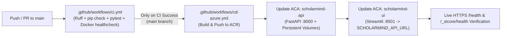

# Microsoft Azure Deployment & CI/CD Architecture Guide
## Research Paper Intelligence Assistant (`ScholarMind AI`)

---

## 1. Azure Service Selection: Container Apps vs. App Service for Containers

| Criterion | Azure Container Apps (Selected) | Azure App Service for Containers |
| :--- | :--- | :--- |
| **Multi-Service Architecture (FastAPI + Streamlit)** | Native side-by-side Container Apps in one managed environment with built-in HTTPS/internal DNS discovery (`SCHOLARMIND_API_URL=https://<api-fqdn>`). | Primarily single-container; multi-container Compose preview is deprecated/limited. |
| **Persistent Storage (SQLite + FAISS + HF Cache)** | First-class Azure Files SMB volume mounts (`/app/data/store`, `/app/artifacts/hf_cache`). | `/home` mount exists, but less flexible for separate model cache vs. document volumes. |
| **CPU/Memory Sizing for PyTorch CPU** | Granular per-service sizing (`2 vCPU / 4 GiB` for API + `1 vCPU / 2 GiB` for UI) without overpaying for idle VMs. | Tied to rigid App Service Plan VM SKUs (`B2`/`P1v3`). |
| **CI/CD & Zero-Downtime Revisions** | Built-in container revisions, traffic splitting, and instant rollback via `az containerapp update`. | Deployment slots require Standard/Premium plans. |

**Decision:** **Microsoft Azure Container Apps (ACA)** backed by **Azure Container Registry (ACR)** and **Azure Files** persistent storage.

---

## 2. CI/CD Pipeline Architecture



---

## 3. Model Weights & Persistence Strategy on Azure

- **Never commit 300–400 MB `.pt` checkpoints or 4 GB `hf_cache/` to GitHub** (violates GitHub's 100 MB file limit).
- **Pretrained Models (`all-MiniLM-L6-v2`, `flan-t5-base`, `flan-t5-small`):** Cached automatically on first request into the mounted **Azure Files share** at `/app/artifacts/hf_cache` (`HF_HOME=/app/artifacts/hf_cache`), so subsequent container restarts and deployments reuse cached weights instantly without re-downloading.
- **SQLite (`scholarmind.db`), FAISS Index (`chunks.faiss`), Embedding Cache & Archived PDFs:** Persisted on the mounted **Azure Files share** at `/app/data/store` (single API replica `min=1, max=1` prevents SQLite/FAISS write-lock contention).
- **Optional Fine-Tuned Checkpoints (`exp_d_t5/best_model.pt`):** Upload optionally to the Azure Files share under `/app/artifacts/checkpoints/exp_d_t5/best_model.pt`; `PaperSummarizationService` detects and loads it automatically when present, or falls back cleanly to pretrained `google/flan-t5-small`.

---

## 4. One-Time Azure Provisioning & GitHub Secrets Setup

### Step 1: Provision Azure Resources
Run from Azure Cloud Shell or any terminal with `az login`:
```bash
bash infra/azure/provision_azure.sh
```

### Step 2: Create a Least-Privilege Service Principal for GitHub Actions
```bash
az ad sp create-for-rbac \
  --name "sp-scholarmind-github-cd" \
  --role contributor \
  --scopes "/subscriptions/<SUBSCRIPTION_ID>/resourceGroups/rg-scholarmind-prod" \
  --sdk-auth
```

### Step 3: Add Repository Secrets in GitHub (`Settings → Secrets and variables → Actions`)

| GitHub Secret | Description |
| :--- | :--- |
| `AZURE_CREDENTIALS` | Full JSON output from `az ad sp create-for-rbac --sdk-auth` |
| `AZURE_RESOURCE_GROUP` | e.g., `rg-scholarmind-prod` |
| `AZURE_ACR_NAME` | ACR registry name (without `.azurecr.io`) |
| `AZURE_API_APP_NAME` | e.g., `scholarmind-api` |
| `AZURE_UI_APP_NAME` | e.g., `scholarmind-ui` |

Once these 5 secrets are added, every merge to `main` automatically runs **CI**, builds & pushes the CPU container to **ACR**, updates **FastAPI** & **Streamlit** on **Azure Container Apps**, and verifies live HTTPS `/health`!
