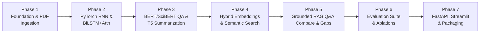

# Development Roadmap & Execution Plan
## Research Paper Intelligence Assistant (`ScholarMind AI`)

This roadmap organizes implementation into **7 incremental, testable engineering phases**. Each phase delivers a working vertical slice with explicit **deliverables**, **dataset integrations**, and **quantitative acceptance gates** so the project remains demonstrable and interview-ready at every milestone.

---

## Roadmap Overview

---

## Phase 1: Project Foundation, Hardware Abstraction & Scientific PDF Ingestion

**Objective:** Establish a clean Python package, multi-tier hardware configuration (`cpu_lite`, `gpu_consumer`, `gpu_research`), dataset streaming utilities, and high-fidelity PDF parsing.

### Deliverables
- [ ] `pyproject.toml`, dependency lock setup, `.env.example`, `ruff`/`pytest` config.
- [ ] `src/scholarmind/core/`:
  - `config.py` (YAML profile inheritance + Pydantic v2 validation)
  - `device.py` (auto CUDA/MPS/CPU detection, AMP dtype selection, deterministic seeding)
  - `model_registry.py` (lazy loading + LRU memory eviction)
  - `schemas.py` (`ParsedPaper`, `PaperSection`, `DocumentChunk`, `PaperStructuredProfile`, `Citation`, `ResearchGapReport`)
- [ ] `src/scholarmind/ingestion/`:
  - `docling_parser.py` (primary layout/table/section parser)
  - `pymupdf_parser.py` (fast CPU fallback)
  - `cleaner.py` (LaTeX/symbol normalization, header/footer artifact removal)
  - `chunker.py` (parent-child section-aware chunking with contextual breadcrumbs)
- [ ] `src/scholarmind/data/` streaming preprocessors for all 4 datasets (`arxiv_loader.py`, `squad_loader.py`, `arxiv_summ_loader.py`, `sciq_loader.py`) + `scripts/prepare_datasets.py`.
- [ ] SQLite `document_store.py` for persisting parsed papers and metadata.

### Acceptance Gate
- Parse 5 diverse multi-column arXiv PDFs (containing tables and equations) into valid `ParsedPaper` JSON with intact section hierarchy and zero garbled reading order.
- Unit tests passing (`pytest tests/unit/test_ingestion.py`).

---

## Phase 2: Foundational Deep Learning in PyTorch (RNN & BiLSTM + Attention)

**Objective:** Build, train, and evaluate custom PyTorch sequence models from scratch on `Cornell-University/arxiv` to demonstrate mastery of core Deep Learning, RNN/LSTM mechanics, and empirical baseline construction.

### Deliverables
- [ ] `src/scholarmind/models/rnn_lstm/`:
  - `vocab.py` (subword/word vocabulary builder + optional pretrained GloVe/FastText initialization)
  - `vanilla_rnn.py` (baseline multi-label classifier)
  - `bilstm_attention.py` (2-layer Bidirectional LSTM + Additive Self-Attention pooling returning interpretable token attention weights)
  - `seq2seq_lstm.py` (compact GRU/LSTM Encoder-Decoder + Bahdanau Attention baseline for abstract generation comparison)
- [ ] `src/scholarmind/training/train_rnn_lstm.py`:
  - Custom PyTorch training loop with `pack_padded_sequence`, gradient norm clipping (`max_norm=1.0`), AMP mixed precision, cosine LR scheduler, early stopping, and local MLflow logging.
- [ ] Train & evaluate on stratified `Cornell-University/arxiv` multi-label CS/AI/ML subset (e.g., 50K train / 5K val / 5K test).
- [ ] Attention heatmap utility showing top scientific keywords driving each paper's predicted discipline.

### Acceptance Gate
- `BiLSTM + Attention` measurably outperforms `Vanilla RNN` on Macro-F1 and Micro-F1 on the ArXiv test split (target: Macro-F1 ≥ 0.78 on top-8 CS/ML categories).
- Clean saved checkpoint + reproducible MLflow metrics + CPU inference < 15 ms/abstract.

---

## Phase 3: Transformer Specialization (BERT/SciBERT Extractive QA & T5/LongT5 Summarization)

**Objective:** Build and fine-tune encoder and encoder-decoder Transformer modules covering Extractive QA (with unanswerable detection), scientific classification, and multi-granularity summarization.

### Deliverables
- [ ] **BERT / SciBERT / DeBERTa-v3 Module (`src/scholarmind/models/bert/`):**
  - `sci_classifier.py`: Fine-tune `allenai/scibert_scivocab_uncased` on the exact same ArXiv split as Phase 2 for direct **RNN vs. BiLSTM+Attention vs. SciBERT** benchmarking, plus a lightweight limitation-cue sentence scorer.
  - `extractive_qa.py`: Fine-tune `SciBERT` / `DeBERTa-v3-base` on **`rajpurkar/squad_v2`** (sliding-window `doc_stride=128`, CLS null-score threshold $\tau$ calibration) + stage-2 domain evaluation/adaptation on **`allenai/sciq`**.
- [ ] **T5 / Flan-T5 / LongT5 Module (`src/scholarmind/models/t5/`):**
  - `summarizer.py`: Implement dual-mode summarization:
    - *GPU Mode:* **`google/long-t5-tglobal-base`** fine-tuned with **PEFT/LoRA** + gradient checkpointing on **`ccdv/arxiv-summarization`**.
    - *CPU Mode:* **`google/flan-t5-base` / `flan-t5-small`** hierarchical section-by-section Map-Reduce summarizer.
  - `onnx_export.py`: Optional INT8 ONNX export pipeline for fast CPU laptop inference.
- [ ] Training scripts (`train_bert_qa.py`, `train_scibert_cls.py`, `train_t5_summarizer.py`) compatible with both local GPUs and Google Colab/Kaggle GPUs.

### Acceptance Gate
- **Classification Ablation:** `SciBERT` outperforms `BiLSTM+Attention` on ArXiv Macro-F1 (logged side-by-side with latency/memory trade-offs).
- **Extractive QA:** Achieves strong SQuAD 2.0 EM/F1 (with balanced `HasAns` and `NoAns` F1) and SciQ reading-comprehension accuracy.
- **Summarization:** Fine-tuned LongT5/Flan-T5 outperforms zero-shot/LSTM baseline on `ccdv/arxiv-summarization` test subset (`ROUGE-1/2/L` and `BERTScore`).

---

## Phase 4: Embeddings, Hybrid Retrieval & Semantic Search Engine

**Objective:** Build a high-precision scientific search engine combining dense semantic embeddings, lexical matching, RRF fusion, metadata filtering, and cross-encoder reranking.

### Deliverables
- [ ] `src/scholarmind/models/embeddings/`:
  - `bge_embedder.py` (`BAAI/bge-m3` dense+sparse on GPU; `BAAI/bge-small-en-v1.5` on CPU)
  - `specter2_embedder.py` (`allenai/specter2_base` scientific baseline for retrieval ablation)
- [ ] `src/scholarmind/retrieval/`:
  - `qdrant_store.py` (embedded Qdrant supporting dense + sparse named vectors and payload filtering by `paper_id`, `section_type`, `categories`, `year`)
  - `faiss_store.py` (FAISS ANN store for ArXiv retrieval benchmarking)
  - `bm25_index.py` (lexical retriever for CPU-lite hybrid fusion)
  - `hybrid_retriever.py` (Dense + Sparse/BM25 + Reciprocal Rank Fusion)
  - `reranker.py` (`BAAI/bge-reranker-v2-m3` on GPU; `ms-marco-MiniLM-L-6-v2` on CPU)
- [ ] `scripts/build_arxiv_index.py` to index a 20K–50K curated ArXiv AI/ML reference corpus alongside user-uploaded PDFs.

### Acceptance Gate
- Quantitative retrieval ablation (`retrieval_eval.py`) on ArXiv + SciQ hard-negative queries demonstrating progressive `nDCG@10` and `Recall@10` improvement: `BM25` < `Dense Only` < `Hybrid (Dense+Sparse RRF)` < `Hybrid + Cross-Encoder Reranker`.
- Sub-second search latency (< 500 ms on CPU-lite; < 150 ms on GPU) over 25K indexed chunks.

---

## Phase 5: LLM Orchestration, Grounded RAG Q&A, Multi-Paper Comparison & Gap Discovery

**Objective:** Integrate the provider-agnostic LLM layer with specialized NLP engines to power advanced scientific reasoning workflows with strict provenance.

### Deliverables
- [ ] `src/scholarmind/models/llm/`:
  - `base.py` (unified interface with retry, token accounting, and Pydantic structured output enforcement)
  - `api_client.py` (Gemini API / OpenAI-compatible provider)
  - `ollama_client.py` (local CPU/GPU GGUF open-weights support)
- [ ] `src/scholarmind/workflows/`:
  - `summarization_service.py` (multi-granularity: *TL;DR*, *Structured Executive Abstract*, *Section Digest*)
  - `rag_qa_service.py` (query decomposition → hybrid retrieval + rerank → SciBERT extractive span & answerability verification → cited LLM answer with explicit refusal on unanswerable queries)
  - `comparison_service.py` (`Map-Extract-Synthesize`: cached `PaperStructuredProfile` extraction → aligned Comparison Matrix + cross-paper trade-off narrative)
  - `gap_analysis_service.py` (Stage 1: explicit limitation retrieval + verbatim quote verification; Stage 2: cross-paper structural research gap synthesis clearly distinguishing `[Author-Stated]` vs. `[AI-Synthesized]`)

### Acceptance Gate
- End-to-end integration tests across 3 real AI/ML research papers (e.g., *Attention Is All You Need*, *BERT*, *LoRA*) verifying:
  - 100% Pydantic schema compliance on `PaperStructuredProfile` and `ResearchGapReport`.
  - ≥ 95% verbatim quote verification pass rate on Stage-1 `[Author-Stated]` limitations.
  - Correct abstention on out-of-scope / unanswerable test questions.

---

## Phase 6: Automated Evaluation Suite, RAGAS & Research Ablation Studies

**Objective:** Consolidate all quantitative experiments into a reproducible evaluation harness that showcases AI/ML Research Assistant rigor.

### Deliverables
- [ ] `src/scholarmind/evaluation/`:
  - `classification_eval.py`: Vanilla RNN vs. BiLSTM+Attention vs. SciBERT (Accuracy, Macro-F1, params, latency)
  - `qa_eval.py`: SQuAD 2.0 (EM, F1, HasAns/NoAns F1) + SciQ accuracy
  - `summarization_eval.py`: LSTM Seq2Seq vs. Flan-T5 Map-Reduce vs. LongT5 LoRA (ROUGE-1/2/L, BERTScore)
  - `retrieval_eval.py`: BM25 vs. SPECTER2 vs. BGE-small vs. BGE-M3 vs. +Reranker (Recall@5/10, MRR@10, nDCG@10)
  - `rag_eval.py`: **RAGAS** (Faithfulness, Answer Relevancy, Context Precision, Context Recall) + Quote Provenance Rate + Closed-Book LLM vs. RAG comparison on SciQ
- [ ] `scripts/run_ablations.py` generating structured JSON/CSV result tables and comparison charts for the UI and README.

### Acceptance Gate
- All 5 benchmark suites execute reproducibly from a single CLI command and log full reports into `artifacts/benchmarks/` and local MLflow.

---

## Phase 7: FastAPI Backend, Streamlit Research Workbench & Portfolio Polish

**Objective:** Deliver a clean, interactive research workbench and documented API ready for live demonstration and code review.

### Deliverables
- [ ] **FastAPI Backend (`src/scholarmind/api/`):**
  - Endpoints for paper upload/parsing, hybrid search, RAG Q&A, multi-granularity summarization, multi-paper comparison, and gap analysis.
  - Auto-generated OpenAPI (`/docs`) specification + background task status tracking for PDF ingestion.
- [ ] **Streamlit Research Workbench (`src/scholarmind/ui/`):**
  - **Tab 1 — Library & PDF Explorer:** Drag-and-drop PDF upload, parsed section tree, extracted tables, BiLSTM/SciBERT predicted discipline + attention token heatmap.
  - **Tab 2 — Hybrid Semantic Search:** Search across uploaded PDFs & ArXiv corpus with dense/sparse/reranker toggles and section filters.
  - **Tab 3 — Grounded Research Q&A:** Multi-turn chat with inline `[Paper, Section, Page]` citations, expandable evidence chunks, and SciBERT extractive confidence badge.
  - **Tab 4 — Multi-Paper Comparison:** Select 2–5 papers → interactive side-by-side matrix (exportable to Markdown/CSV) + synthesis narrative.
  - **Tab 5 — Gap & Limitation Finder:** Two-column view separating verified `[Author-Stated Limitations]` (with source quotes) from `[Synthesized Cross-Paper Research Gaps]`.
  - **Tab 6 — Model Benchmarks & Ablations:** Live interactive Plotly dashboards displaying Phase 6 ablation results across RNN, BiLSTM, SciBERT, T5/LongT5, Embeddings, and RAGAS.
- [ ] Complete `README.md` with architecture diagrams, quickstart commands (`cpu_lite` vs `gpu_consumer`), benchmark tables, and sample demo walkthrough.

### Acceptance Gate
- Fresh install & end-to-end smoke test passing on `cpu_lite` profile (and verified GPU profile script).
- Full `pytest` suite green, `ruff` lint clean, zero hardcoded secrets or machine-specific paths.

---

## Recommended Execution Cadence

| Milestone | Phases Included | Portfolio / Demo Value |
| :--- | :--- | :--- |
| **Milestone A — Core ML & Data Engine** | Phases 1–2 | Proves clean Python architecture, PDF parsing, dataset streaming, and from-scratch PyTorch RNN/BiLSTM mastery. |
| **Milestone B — Transformer & Retrieval Mastery** | Phases 3–4 | Proves BERT/SciBERT fine-tuning (SQuAD 2.0/SciQ), T5/LongT5 summarization (ArXiv), and modern Hybrid Search + Reranking. |
| **Milestone C — Full Research Assistant Product** | Phases 5–7 | Delivers end-to-end RAG Q&A, Multi-Paper Comparison, Grounded Gap Discovery, RAGAS benchmarks, FastAPI, and Streamlit UI. |
